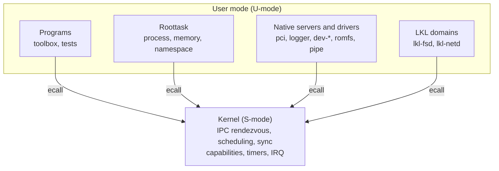

# RTMux

RTMux is a 64-bit, POSIX-oriented, capability-based microkernel for RISC-V,
aimed at realtime systems.

- **Small privileged core.** The S-mode kernel does only synchronous IPC
  rendezvous, scheduling, synchronization, capability checks, timers, and
  trap/interrupt delivery.
- **Services in user space.** Filesystems, drivers, the namespace, and memory and
  process policy are ordinary processes speaking IPC.
- **POSIX-visible behavior.** `posix_spawn`, pthreads, signals, `crypt(3)` login,
  and a toolbox userland. A configurable conformance profile (PSE51 up to the
  full set) controls what the headers and `sysconf()` advertise.
- **Linux reuse without Linux in the kernel.** Optional `lkl-fsd` and `lkl-netd`
  servers run the Linux Kernel Library (LKL) in user-mode service domains for
  ext4 and TCP/IP.
- **Measured, not asserted.** POSIX coverage, realtime budgets, and the LKL
  boundary are backed by generated evidence and CI gates.

For the design vision, start with the [manifesto](docs/manifesto.md).

## Status

Version 0.11. RTMux boots to a multi-user `login:` on QEMU virt (up to 8 harts)
and on a SiFive HiFive Unmatched (FU740), where it sustains repeated process
spawn and exit. There is no big kernel lock; system calls and roottask messages
run concurrently under per-object locks.

What works and what is planned is listed in [docs/status.md](docs/status.md).

## Architecture



| Layer | Role |
|-------|------|
| Kernel | Brokers IPC, schedules threads (with priority inheritance), checks capabilities, takes traps and interrupts. No filesystem, network, or path policy. |
| Roottask | First user process: process management, memory policy, and the namespace (`/dev`, `/proc`, `/sys`). Enters the kernel through the same `ecall` path as any program. |
| Servers and drivers | `romfs`, `dev-nvme`, `dev-serial-*`, `pci`, `logger`, `pipe`: separate processes reached over IPC. |
| LKL domains | Optional Linux-derived filesystem and network services, contained outside the kernel. |

A filesystem bug is therefore in `userland/romfs/`, not in the kernel. See
[docs/architecture.md](docs/architecture.md) for the privilege split, SMP and
capability contracts, kernel subsystem map, and source layout.

## Quick start

Prerequisites: a RISC-V bare-metal toolchain (`riscv-none-elf-`), `lld`,
`qemu-system-riscv64`, OpenSBI, `git`, and `python3`.

```bash
make defconfig     # first time only
make               # kernel + roottask + libc + userland + initramfs.cpio
make qemu          # build and boot; log in as root / RTMux
```

Build commands, POSIX profile selection, LKL builds, QEMU options, and CI are in
[docs/building.md](docs/building.md).

The [AArch64 / Raspberry Pi 3B port](docs/pi3.md) boots the native kernel,
roottask and interactive shell on four QEMU CPUs, without Linux or LKL.
Select `configs/pi3_defconfig`, then use `make pi3`, `make qemu-pi3` or
`make check-pi3`. For shared RISC-V syscall, POSIX profile, IRQ, serial, block/VFS
and scheduling coverage, select `configs/pi3_coverage_defconfig` and run
`make check-pi3-coverage` plus `make check-pi3-profiles`. The separate `make check-pi3-bringup` target retains the
low-level architecture diagnostics.

## POSIX conformance profiles

| Profile | Scope |
|---------|-------|
| `minimal` | PSE51 mandatory realtime |
| `realtime` | PSE52 filesystem + PSE53 process |
| `lkl` | Measured floor needed by the LKL servers |
| `full` (default) | Every advertised option |

Select one with `DEFCONFIG=configs/profile-<name>.config make defconfig`. A
smaller profile de-advertises what it does not support; the per-interface status
is generated in [docs/posix-compliance.md](docs/posix-compliance.md).

## Verification and CI

`make check` runs the static gates, boots RTMux under QEMU, and runs the
conformance suites. GitHub Actions builds every POSIX profile and boots each one
in QEMU, builds the RV64 LKL archives from `lkl/linux`, and runs RTMux+LKL on
QEMU (containment, smoke, and differential oracles). Details are in
[docs/building.md](docs/building.md#verification).

## Documentation

| Topic | Documents |
|-------|-----------|
| Vision and status | [manifesto](docs/manifesto.md), [status](docs/status.md) |
| Architecture | [architecture](docs/architecture.md), [syscalls](docs/syscalls.md), [boot manifest](docs/boot-manifest.md) |
| Concurrency and realtime | [smp-contract](docs/smp-contract.md), [pi-pc-design](docs/pi-pc-design.md), [irq-contract](docs/irq-contract.md), [rt-budgets](docs/rt-budgets.md) |
| Capabilities and safety | [capability-law](docs/capability-law.md), [capability-abi](docs/capability-abi.md), [fault-recovery](docs/fault-recovery.md) |
| POSIX and porting | [posix-compliance](docs/posix-compliance.md) (generated), [porting](docs/porting.md) |
| Linux reuse | [lkl-domain](docs/lkl-domain.md), [vfs-contract](docs/vfs-contract.md) |
| Building and contributing | [building](docs/building.md), [conventions](docs/conventions.md) |

## License

Apache License 2.0 across the whole tree. See [LICENSE](LICENSE).
