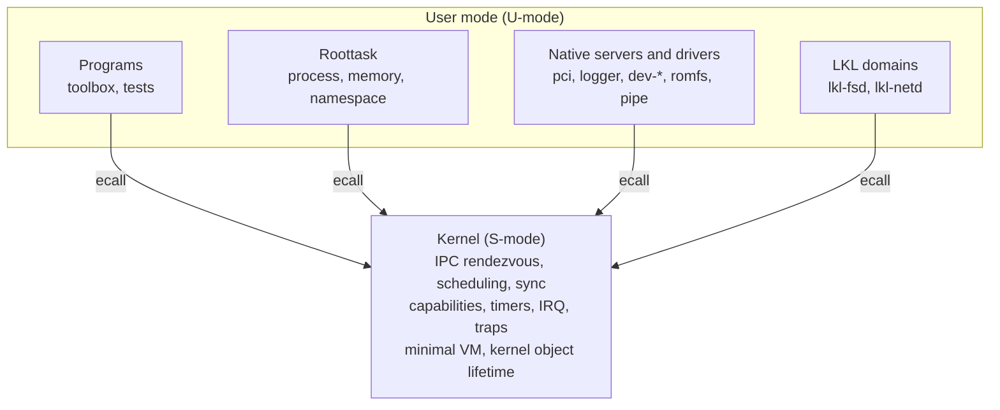

# RTMux Architecture

RTMux is a 64-bit RISC-V microkernel. The design rule is that the S-mode kernel
keeps only what must be privileged, and everything else is an ordinary user-mode
process that talks to its clients over synchronous IPC. A filesystem bug is
therefore in `userland/romfs/`, not in the kernel. The strategic rationale is in
[manifesto.md](manifesto.md); this page is the structural map.

## Privilege split



**Kernel.** Brokers IPC rendezvous (`MsgSend`/`MsgReceive`/`MsgReply`),
schedules threads (FIFO, round-robin and other policies with priority
inheritance), implements synchronization primitives, checks capabilities,
drives timers, and takes traps and interrupts. It contains no filesystem,
network stack, or path-management policy.

**Roottask.** The first user-mode process. It owns process management (spawn,
wait, detach), memory policy (address spaces, page tables, allocator), and the
namespace service (`/dev`, `/proc`, `/sys`, named semaphores). It enters the
kernel through the same `ecall` path as any other program; the privileged
operations it needs are granted by the bootstrap capability manifest
([boot-manifest.md](boot-manifest.md)).

**Servers and drivers.** Filesystems (`romfs`), block and serial drivers
(`dev-nvme`, `dev-serial-8250`, `dev-serial-sifive`), the PCIe server, the
system logger, and the pipe service are separate processes. Opening a file or
reading a block is an IPC round trip to the relevant service
([service-frontend-abi.md](service-frontend-abi.md), [vfs-contract.md](vfs-contract.md)).

**LKL domains.** Optional `lkl-fsd` and `lkl-netd` servers run the Linux Kernel
Library in user mode to reuse Linux ext4 and TCP/IP. Clients never call LKL
directly; the kernel stays outside the Linux domain
([lkl-domain.md](lkl-domain.md)).

## Cross-cutting contracts

| Concern | Summary | Document |
|---------|---------|----------|
| SMP and locking | No big kernel lock. Per-object locks (channel, connection, per-process thread vector, per-CPU run queues, kernel heap); IPC and sync paths coordinate with per-thread bridge bits and `fence rw, rw` rather than mutual exclusion; RCU-sched for pid/receive-id lookup. | [smp-contract.md](smp-contract.md), [smp-invariants.md](smp-invariants.md) |
| Capabilities | Handles carry explicit rights, rights can be attenuated before delegation, and delegation is visible and revocable. | [capability-law.md](capability-law.md), [capability-abi.md](capability-abi.md) |
| Priority inheritance | PI across synchronous IPC and sync objects. | [pi-pc-design.md](pi-pc-design.md) |
| Interrupts | Kernel acknowledges and wakes; handling runs in user-mode interrupt threads. | [irq-contract.md](irq-contract.md) |
| Realtime budgets | Measured scheduler, IPC, timer, and trace budgets with generated evidence. | [rt-budgets.md](rt-budgets.md) |
| Syscall ABI | `ecall`, number in `a7`, arguments in `a0-a5`. | [syscalls.md](syscalls.md) |
| Fault recovery | Server restart and fault-containment rules. | [fault-recovery.md](fault-recovery.md), [server-restart-contract.md](server-restart-contract.md) |

## Kernel subsystems

| Subsystem | Files |
|-----------|-------|
| Message passing | `kernel/ipc/message.c`, `fastmsg.c`, `message-core.c` |
| Channels and connections | `kernel/ipc/channel.c`, `connect.c`, `connect-core.c` |
| Threads and scheduling | `kernel/thread/lifecycle.c`, `kernel/sched/policy.c`, `dispatch.c` |
| Synchronization | `kernel/sync/wait.c`, `core.c`, `rcu.c` |
| Capabilities and credentials | `kernel/cap/table.c`, `kernel/security/cred.c` |
| Memory and transfer | `kernel/mm/core.c`, `map-xfer.c`, `kernel/xfer/` |
| Fault handling | `kernel/fault/core.c` |
| Timers and clocks | `kernel/time/timer.c`, `timer-core.c`, `clock.c`, `clock-core.c` |
| Interrupts | `kernel/irq/interrupt.c`, `core.c` |
| Syscall dispatch | `kernel/core/sys.c`, `arch/riscv/calls.c` |
| Object allocator | `kernel/object/alloc.c`, `core.c`, `vector.c` |
| ELF program loader | `kernel/module/initramfs-elf.c` (ET_DYN) |

## Source layout

```
arch/riscv/              RISC-V port: vectors, traps, SBI, context switch
    startup/                 head.S, startup entry, MMU setup
    include/                 CPU headers (context.h, cpu-paging.h, sbi.h)
    platform/qemu_virt/      QEMU virt platform code
kernel/                  Linked into rtmux-kernel
    startup/ init/ core/     Boot, object setup, syscall entry, shutdown
    ipc/ sched/ thread/      Message passing, scheduler, thread lifecycle
    sync/ time/ irq/         Sync kcalls and RCU-sched, timers, interrupts
    object/ cap/ security/   Allocation and lookup, capability table, credentials
    mm/ xfer/ fault/         Kernel memory, cross-AS copy, fault handling
    module/ ext/             ELF loader, kernel extensions
    printk/ debug/ trace/    kprintf, lock debug and stall detector, tracing
    lib/ include/            Kernel-internal helpers and headers
servers/                 User-mode servers
    roottask/                sys/ proc/ mem/ path/
    pci/ logger/             PCIe enumeration, system logger
    lkl/ lkl-fsd/ lkl-netd/  LKL host glue and the two personality servers
    virtio-mmio/             virtio-mmio support
userland/                Programs and drivers
    utils/                   toolbox applets (sh, vi, getty, login, ls, ps, top, ...)
    dev-serial-8250/ dev-serial-sifive/ dev-nvme/ romfs/ pipe/
    init                     first-stage /sbin/init
lib/libc/  lib/ldso/     C library (libc.so) and runtime linker (ld-rtmux.so)
include/                 Public user-visible headers
tests/                   syscall_testing and focused suites
tools/                   Host utilities (mkromfs, treeromfs, mkasmoff, Kconfiglib)
scripts/                 Host scripts: emulation, gates, generators, probes
mk/                      Shared make fragments
configs/                 defconfig, POSIX profile and LKL config fragments
formal/                  Formal models used by the check-formal gates
boot/                    U-Boot boot script
docs/                    Design notes and contracts
```
