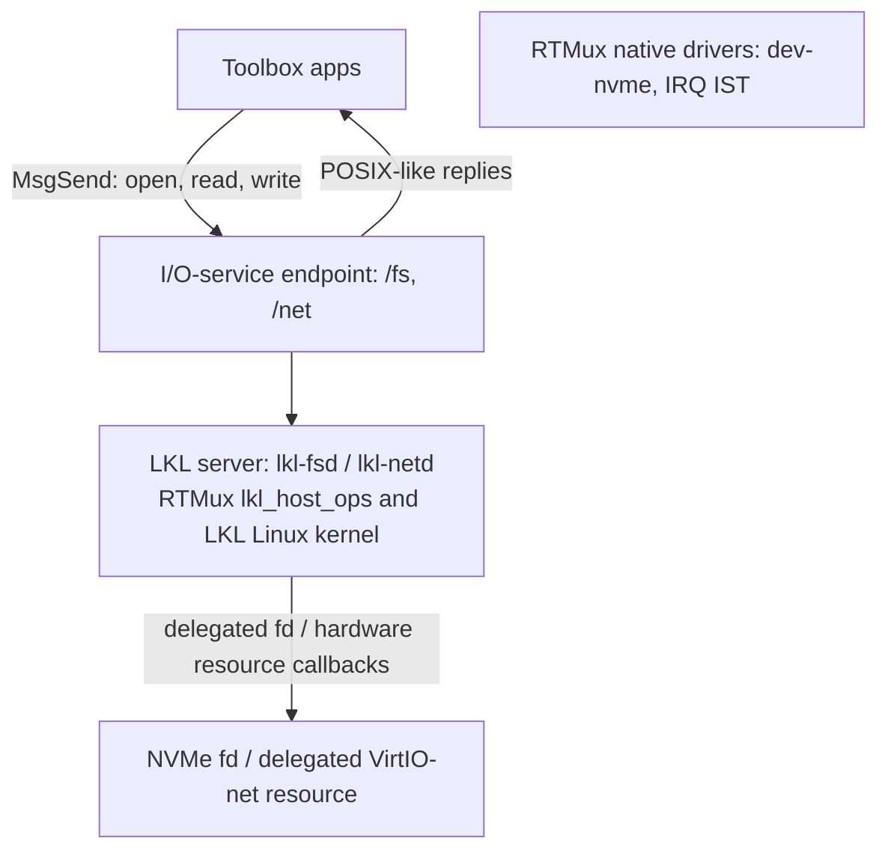

# LKL Domain Boundary

LKL reuse is an optional user-mode personality, not kernel code and not a
shortcut around RTMux I/O services.

## Architecture at a Glance

RTMux keeps Linux driver reuse in ordinary user-space servers.  The kernel still
only schedules threads, brokers IPC, manages capabilities, and delivers
interrupts.  LKL runs inside `lkl-fsd` or `lkl-netd`; clients never call LKL
directly.



These components run in RTMux user space; the RTMux kernel remains outside the
Linux domain.

The important boundary is the I/O-service endpoint.  A client sees
ordinary paths such as `/fs/root/hello.txt` or `/net/tcp/clone`.
Behind those paths, the server translates RTMux I/O messages into serialized
LKL syscalls and host callbacks.

```
LKL server implementation pattern

  RTMux I/O-service callbacks
      open / read / write / readdir / stat / devctl
              |
              v
  one LKL entry point per server operation
              |
              v
  lkl_host_ops
      time, memory, semaphores, threads, block fd,
      delegated VirtIO-net transport
              |
              v
  delegated RTMux resource

filesystem path

  cp /fs/root/hello.txt /fs/root/copy.txt
       |
       v
  RTMux open/read/write messages
       |
       v
  lkl-fsd I/O service
       |
       v
  LKL ext4 syscalls
       |
       v
  delegated block fd -> RTMux NVMe partition/image

network path

  nc 10.0.2.2 8000 --http-get
       |
       v
  /net/tcp/clone -> /net/tcp/N/ctl + /net/tcp/N/data
       |
       v
  lkl-netd I/O service
       |
       v
  LKL TCP/IP stack
       |
       v
  delegated VirtIO-net over QEMU user networking
```

Device-resource model: `lkl-fsd` uses the tier-a fd-backed host-resource model
for ext4 storage (a delegated RTMux block fd, no Linux block driver reuse).
`lkl-netd` uses the delegated VirtIO-net model: the parent process starts a
child with `--delegated-virtio`, asks `/dev/virtio-mmio` to hand that child the
registered `VIRTIO_ID_NET` typed record, and the child maps only that delegated
record before sealing itself with `_PROC_PHYS_CONTAIN`.  LKL still owns the
TCP/IP stack and calls `lkl_netdev_add()` through the RTMux LKL host shim, but
the packet path is QEMU's `virtio-net-device` plus unprivileged user networking
for the QEMU regression target.  SiFive Unmatched/FU740 remains the separate
hardware-provider target for the same typed-device contract.

Host callbacks must block on RTMux synchronization primitives, not poll with
timed sleeps.  In particular, `lkl_host_ops.sem_down()` waits on the semaphore's
condition variable and `sem_up()` signals it while holding the same mutex.  This
keeps LKL worker wakeups visible to SMP clients blocked in RTMux IPC reply
state.

## QEMU/FU740 Acceptance

QEMU remains the full-featured development and analysis target on both Linux
(reference-host) and macOS (localhost), and these QEMU gates must not require superuser
privileges.  SiFive Unmatched/FU740 is the real-hardware acceptance target.
Passing QEMU alone is not enough for hardware claims; passing FU740 alone is not
enough to remove QEMU regression, performance, trace, or differential coverage.

| Domain | QEMU functional | QEMU differential / analysis | QEMU latency / trace | FU740 functional | FU740 latency / logs |
| --- | --- | --- | --- | --- | --- |
| `lkl-fsd` | `CPUS=8 scripts/qemu-regress.sh --mode lkl-fsd-tree --timeout 360 --keep-logs`; artifact `build/lkl-logs/lkl-fsd-tree-1.log`; pass requires `RTMux lkl-fsd-tree: PASS`, nonzero `lkl_block_read_bytes`, and nonzero `lkl_block_write_bytes`. | `CPUS=8 scripts/qemu-regress.sh --mode lkl-fsd-tree --timeout 360 --keep-logs --differential`; artifact `build/lkl-logs/lkl-fsd-tree-1.log`; pass requires non-root `e2fsck` plus `debugfs` read-back of the guest-written ext4 image. | `CPUS=8 scripts/qemu-regress.sh --mode tracelogger-lkl-fsd --timeout 360 --keep-logs`; artifacts `build/lkl-logs/tracelogger-lkl-fsd-1.log`, `.sched.csv`, `.lkl-host.csv`, `.irq.csv`, `.rt-budget.md`, and `.ctf/`; pass requires the mode PASS marker and `scripts/rt-budgets-check.py --schema-only` success on the generated budget artifact. | `scripts/fu740-fsd-smoke.sh --log build/fu740-logs/lkl-fsd-tree.log --runner '<board command that boots rtmux.run=lkl-fsd-tree>'`; pass requires `lkl-fsd-board: ... FU740 ...`, `RTMux lkl-fsd-tree: PASS`, nonzero block read/write counters, no FAIL marker, and no crash/fault signature. The board command must exercise the real RTMux storage path, not a QEMU-only block backend. | `scripts/fu740-fsd-smoke.sh --require-timing-metadata --log build/fu740-logs/lkl-fsd-tree-latency.log --runner '<board command that boots rtmux.run=lkl-fsd-tree>'`; pass requires the same functional markers plus `lkl-fsd-timer: ...` and request/native-wake rows copied into `docs/rt-budgets.md`. |
| `lkl-netd` | `CPUS=8 scripts/qemu-regress.sh --mode lkl-netd-http --timeout 360 --keep-logs` and `CPUS=8 scripts/qemu-regress.sh --mode lkl-netd-revoke --timeout 180 --keep-logs`; artifacts `build/lkl-logs/lkl-netd-http-1.log` and `build/lkl-logs/lkl-netd-revoke-1.log`; pass requires delegated VirtIO-net bring-up, ICMP/DNS/UDP/TCP smoke, crash/revoke cleanup, and nonzero `net_bounce_rx_bytes`/`net_bounce_tx_bytes`. | `CPUS=8 scripts/qemu-regress.sh --mode lkl-netd-http --timeout 300 --differential`; artifact is the kept or temporary guest log named by the harness; pass requires delegated VirtIO-net HTTP/UDP smoke, latency rows, and copy counters through the QEMU user-networking peer. | `CPUS=8 scripts/qemu-regress.sh --mode tracelogger-lkl-netd --timeout 360 --keep-logs`; artifacts `build/lkl-logs/tracelogger-lkl-netd-1.log`, `.sched.csv`, `.lkl-host.csv`, `.irq.csv`, `.rt-budget.md`, and `.ctf/`; pass requires the mode PASS marker and `scripts/rt-budgets-check.py --schema-only` success on the generated budget artifact. | `scripts/fu740-netd-smoke.sh --log build/fu740-logs/lkl-netd.log --runner '<board command that boots lkl-netd-http and lkl-netd-revoke with the FU740 packet provider>'`; pass requires `lkl-netd-board: ... FU740 ...`, `lkl-netd-provider: <native packet provider>`, `/sbin/lkl-netd --serve-net` on the board path, ICMP, DNS/UDP, TCP HTTP, blocked-poll/backpressure, nonzero RX/TX stats, crash revoke, namespace cleanup, no FAIL marker, and no crash/fault signature. | `scripts/fu740-netd-smoke.sh --require-timing-metadata --log build/fu740-logs/lkl-netd-latency.log --runner '<board command that boots lkl-netd-http and lkl-netd-revoke with the FU740 packet provider>'`; pass requires the functional smoke plus `lkl-netd-timer: ...`, `/net/stats`, request/native-wake rows, and copied budget notes in `docs/rt-budgets.md`. |

Unsupported/skipped cases must be explicit in the artifact.  Today that means
IOMMU preflights on QEMU hosts that cannot instantiate a usable RISC-V PCI
IOMMU, cannot expose `virt,iommu-sys=on`, or cannot provide a system-IOMMU MMIO
binding for `virtio_mmio@...`; that system-IOMMU MMIO binding is required
before domain/fault/revoke modes can claim a platform-device DMA boundary.
These are native-device/hardware preflights, not prerequisites for the QEMU
`lkl-netd-http` delegated VirtIO-net acceptance.
The patched-DTB `lkl-iommu-metadata` mode proves only FDT phandle/stream
metadata preservation through startup hwinfo, `/dev/virtio-mmio`, and the
delegated-handle query; it is not a DMA containment or domain-programming
result.
The `lkl-netd-iommu-fail-closed` mode boots the same patched-DTB fixture through
the delegated LKL net path and passes only when `lkl-netd` logs the delegated
IOMMU phandle/stream, maps the delegated system-IOMMU MMIO control record,
reads `capabilities` and `ddtp`, validates the RISC-V IOMMU 1.0 version field,
logs the sampled `ddtp` mode, builds the virtio queue and bounce-buffer DMA
allowlist, temporarily programs stream 42 with an identity Sv39x4 allowlist for
those pages, proves one allowed and one denied debug translation, clears the
context, and refuses before posting RX descriptors or setting `DRIVER_OK` because
the local QEMU fixture still does not enforce that domain for the live MMIO
virtio device.

`make check-fu740-smoke-scripts` uses synthetic FU740 logs to validate the
hardware-smoke parser rules. It does not replace the FU740 runs above; it keeps
the expected PASS markers, copy counters, board metadata, and fail-closed log
checks executable while the board remains unavailable.

## Authority

An LKL domain starts with no hardware authority.  Bootstrap may delegate only:

- MMIO ranges: explicit typed-memory fd; absent by default.
- QEMU system IOMMU MMIO: when the FDT exposes `compatible = "riscv,iommu"`,
  RTMux publishes a `riscv-iommu` hwinfo device with the advertised IRQ tags.
  `/dev/virtio-mmio` still registers `RTMUX_DEVICE_RISCV_IOMMU` as the MMIO
  window plus the current single first-IRQ handle; a multi-IRQ resource ABI and
  domain programming remain open.
  `scripts/qemu-regress.sh --mode lkl-iommu-sys-probe` boots
  `virt,iommu-sys=on`, checks the hwinfo IRQ tags, delegates the typed
  resource, maps the IOMMU MMIO page, and verifies the RISC-V IOMMU 1.0
  `capabilities.version` plus reset `ddtp` mode fields.  It also allocates a
  zeroed physically contiguous DDT root page, probes which legal
  `ddtp.iommu_mode` directory-table modes are retained, restores the reset
  Off/Bare mode, and reports the retained mode mask.
  `lkl-iommu-domain-preflight` first runs the patched-DTB metadata check, decodes
  the delegated virtio stream from the returned handle, then runs the
  command/debug-translation sequence under the same fixture by spawning
  `/bin/lkl-iommu-probe --domain --did <stream> --iova 0x400000`.  This keeps the
  synthetic DID 42 translation check in the same boot shape as the delegated
  virtio stream metadata, but the probe still uses that stream only as a
  synthetic DID fixture rather than binding the live virtio device.  It allocates a
  physically contiguous command queue, programs `cqb`/`cqt`/`cqcsr`, observes
  `cqon`, installs a temporary Bare/Bare/Off device context for DID 42 under
  1LVL mode, submits `IODIR.INVAL_DDT`, fences it with a zero-payload `IOFENCE.C`,
  requires `capabilities.DBG`, then issues a debug translation
  request for DID 42 and checks that the temporary Bare context resolves the
  IOVA to the same physical page.  DID 42 is the same numeric value used by the
  patched-DTB metadata fixture's synthetic virtio stream.  It still does not
  bind the delegated virtio stream to the context or claim DMA containment.  The
  same probe then replaces that DID's DC with a synthetic Sv39x4 second-stage
  context, installs a 16 KiB-aligned root plus leaf page tables with one mapped IOVA,
  invalidates/fences DID 42 again, and checks that debug translation resolves the
  mapped IOVA while faulting the neighboring unmapped page.  It then clears the
  mapped leaf PTE, submits `IOTINVAL.GVMA`, fences with `IOFENCE.C`, and checks a
  fresh debug translation faults.  That last check proves command
  acceptance/sequencing plus the post-clear page-table result; it is not a
  stale-IOTLB invalidation proof because QEMU debug translation does not populate
  the IOT cache.  The probe defaults to DID 42 and IOVA 0x400000 for the patched
  fixture, but accepts explicit DID/IOVA arguments so a later real-stream binding
  can reuse the same command path.  It then restores the reset Off/Bare mode and
  disables the queue again.
  If firmware supplies an MMIO virtio `iommus = <phandle stream>` specifier,
  startup records both the IOMMU phandle and the first stream argument in the
  virtio hwinfo node.  `/dev/virtio-mmio` preserves the phandle directly and
  preserves the stream as `stream + 1`, so zero remains the "not described"
  sentinel for each field.  The LKL virtio handoff logs and preserves those
  fields, temporarily programs and clears the observed stream when delegated
  IOMMU control is present, then fails closed instead of driving the device
  until live MMIO virtio DMA enforcement exists.  `lkl-contain` rejects
  inconsistent synthetic phandle/stream
  records.  `lkl-iommu-metadata` boots a patched-DTB QEMU fixture whose MMIO
  virtio nodes get `iommus = <phandle 42>`, then delegates the real virtio-net
  handle and checks that the phandle plus stream 42 survive through startup
  hwinfo, `/dev/virtio-mmio`, and the delegated-handle query.  This is metadata
  plumbing only; the
  domain/fault/revoke modes below still require real device-domain programming
  before they can pass.  `lkl-iommu-domain-preflight` runs the system-IOMMU
  DID-42 programming checks under that patched fixture with the observed stream
  passed as `--did`; it proves the synthetic domain allow/deny/debug path in the
  same boot that carries the virtio stream metadata, not that QEMU enforces DMA
  for the virtio device.
  `lkl-netd-iommu-fail-closed` uses the same patched-DTB fixture for the actual
  LKL virtio-net handoff, delegates the system-IOMMU MMIO control record to the
  LKL child when a virtio stream is described, requires the child to map that
  control block, read `capabilities`/`ddtp`, validate the RISC-V IOMMU 1.0
  version field, log the sampled `ddtp` mode, collect the exact virtqueue and
  bounce-buffer DMA ranges it would map, temporarily program stream 42 with an
  identity Sv39x4 allowlist for those pages, prove one allowed and one denied
  debug translation, clear that context, and fail closed with `IOMMU domain
  enforcement unavailable` before RX descriptors are posted or `DRIVER_OK` is
  written.  This proves the LKL child received a readable delegated control
  window, reached the bounded DMA allowlist point, and can program/clear the
  observed stream before refusal; it still does not prove that QEMU routes the
  live MMIO virtio device's DMA through that domain or authorize the virtio
  device.
  The domain/fault/revoke gates also inspect QEMU's DTB and stay
  `UNSUPPORTED` unless at least one `virtio_mmio@...` node names that system
  IOMMU in the first phandle cell of its `iommus` property.  The preflight
  ignores later specifier cells so an argument value cannot masquerade as an
  IOMMU binding.
  The gate dumps the best-case `virtio-net-device,iommu_platform=on` DTB; local QEMU 11.0.2 still emits no MMIO `iommus` binding there, and
  the reference host's QEMU 8.2.2 lacks `riscv-iommu-sys` support entirely.
  With `--keep-logs`, preflight evidence is kept as
  `build/lkl-logs/<mode>-iommu.{dtb,dts,err}` when those artifacts exist.
- IRQ endpoints: a native RTMux IST owns ack/mask/unmask and notifies LKL by
  async notification only.  The IST never blocks on an SRR to the domain, so a
  descheduled or crashed LKL domain cannot stall interrupt servicing or blow
  the IRQ-to-IST budget.
- DMA buffers: explicit shared-memory fd with bounded size and direction.
  Bounding the fd bounds only what LKL *sees*; it does not bound what the
  device's DMA engine can *write*.  Secure DMA containment requires hardware
  restriction of the device DMA view to that buffer, using RISC-V IOMMU where
  present.  IOPMP is an M-mode/firmware track and needs an SBI delegation
  contract before S-mode can rely on it; PMP is CPU-side and is not a DMA
  remapper.  Without IOMMU/IOPMP enforcement, MMIO delegation is a
  fault/isolation boundary for LKL code but not a DMA-security boundary, and the
  delegating service must treat the device as DMA-trusted.
- Block devices for `lkl-fsd`: delegated RTMux file descriptor backed by a
  block image or QEMU NVMe partition.  `lkl-fsd` registers that fd through the
  shared LKL block backend.  This is Linux filesystem reuse, not Linux block
  driver reuse; RTMux's native block driver still owns NVMe hardware.
- Namespace binds: selected `/fs/*` or `/net/*` subtrees only; native RTMux
  paths stay outside the LKL domain.

Crash boundary: the `lkl-fsd` or `lkl-netd` process may die without taking the
kernel, native filesystems, `/net` absence policy, or other I/O services
with it.  Revocation boundary: on domain exit (clean or crash) the delegating
service must quiesce the hardware *before* reclaiming endpoints — mask the
device IRQ, then reset the device (or disable its IOMMU domain) so a babbling
device cannot keep DMAing into reclaimed buffers or storming interrupts — and
only then close the delegated fds, tear down shared mappings, unbind the
namespace subtree, and revoke the cap group.  Outstanding client handles bound
to the dead domain fail with a named errno rather than hanging.  Fallback: if
the domain is absent, native RTMux filesystems and POSIX paths keep their
current behavior.

### DMA / MMIO Containment (LKL-domain seal enforced; hardware DMA track pending)

The Authority contract above says MMIO comes from an explicit delegated region,
absent by default.  `lkl-netd` starts as a parent launcher, spawns a
`--delegated-virtio` child, asks `/dev/virtio-mmio` to delegate the registered
net-device record to that child, and the child maps only the delegated
VirtIO-net MMIO/IRQ/DMA resources before sealing itself with
`_PROC_PHYS_CONTAIN`.  User `MAP_PHYS`
reaches roottask (`servers/roottask/mem/vm-map.c`); after
`_PROC_PHYS_CONTAIN`, roottask checks specific-address maps against the caller's
claimed `HWRES_MEMORY` / `HWRES_PCI_MEMORY` ranges instead of only checking
root/access plus the global `last_paddr` ceiling.  This closes the
post-containment ambient CPU-mapping hole for LKL domains.  It is still not a
DMA-security boundary for hardware-backed domains; hardware IOMMU or a trusted
device bounce path remains required before treating a delegated device as
malicious.

Platform inventory:

| Platform | Hardware DMA enforcement usable for delegated LKL domains | RTMux follow-up |
| --- | --- | --- |
| QEMU `virt` | IOMMU hardware is host-version-dependent: `lkl-iommu-probe` covers PCI IOMMU enumeration when QEMU can instantiate an IOMMU-class PCI device on `virt`; `lkl-iommu-sys-probe` covers the `riscv-iommu-sys` MMIO resource behind `virt,iommu-sys=on` through register and retained-DDT-mode probing; `lkl-iommu-metadata` covers patched-DTB MMIO virtio phandle/stream preservation; `lkl-iommu-domain-preflight` pairs that patched fixture with synthetic DID-42 command-queue, debug-translation, Sv39x4 allow/deny, and post-clear fault probing; and `lkl-netd-iommu-fail-closed` covers the delegated LKL child mapping the system-IOMMU control window, validating `capabilities.version`, sampling `ddtp`, collecting the virtqueue/bounce-buffer DMA allowlist, temporarily programming/clearing stream 42, and refusing before the virtio device is driven. The current MMIO `virtio-net-device` path is not a usable DMA boundary unless its `virtio_mmio@...` DTB node has an `iommus` binding to that system IOMMU and RTMux programs the matching domain. Unsupported hosts, metadata-only fixtures, synthetic domain preflights, and fail-closed handoffs remain skip-aware through those preflights. | Implement the QEMU RISC-V IOMMU domain path for the current MMIO `virtio-net-device`: discover the system IOMMU, bind delegated platform-device IDs to a per-domain translation context, map only delegated buffers, and make `lkl-iommu-domain` / `lkl-iommu-dma-deny` / `lkl-iommu-revoke` reach enforcement instead of the current unsupported/programming gap. |
| FU740 / HiFive Unmatched | Not usable today as a per-device delegated DMA boundary. The FU740 manual documents CPU PMP, PDMA, PCIe/GEMGXL DMA masters, and a DDR-subsystem Physical Filter with Device PMP registers, but no RISC-V IOMMU or IOPMP block that can bind one RTMux domain's device to one delegated DMA range. The Physical Filter is a coarse DDR-controller allowlist, not a per-device I/O address-translation domain. | Keep the DMA-security caveat for FU740 hardware-backed domains. A future FU740 task must either prove a firmware/SBI contract for programming the Physical Filter safely or keep the provider trusted-device-only. |

Typed VirtIO-MMIO delegation is enforced before an LKL domain seals itself.  The
`/dev/virtio-mmio` registry accepts only non-revoked records with nonzero
generations, delegates records to a named pid by claiming the corresponding
hardware range, and rolls back every range it claimed if a later claim or
delegation-table insert fails.  A delegated record is one-shot: the target
process consumes it by query, and the target owns the hardware-resource claim
until it releases the returned handle's range.  An undersized query fails with
`EMSGSIZE` before consuming any records.

A process sends `_PROC_PHYS_CONTAIN` to roottask once it has mapped all device
MMIO it needs.  Roottask sets a monotonic per-process `phys_contained` flag
(under the address-space write lock, so it serializes with in-flight maps).
While set, `vm-map.c` allows a further specific-address `MAP_PHYS` only when the
requested physical range is inside one of the caller's claimed `HWRES_MEMORY` or
`HWRES_PCI_MEMORY` ranges; otherwise it fails with `EPERM`.  The check runs
after fd resolution too, so fd-backed `/dev/mem` cannot bypass it after
`devmem_check()` adds `MAP_PHYS`; raw `/dev/mem` read/write is also refused for
a contained caller, so roottask cannot map physical memory internally on its
behalf after the seal.  `MAP_ANON` DMA buffers stay exempt, because a domain
receives its MMIO claims up front and only needs anonymous DMA afterward.
`lkl-fsd` has no delegated MMIO window; `lkl-netd` maps only the delegated
VirtIO-net window.  Both apply the seal before serving any client path.

The regression `scripts/qemu-regress.sh --mode lkl-contain` proves a baseline
`MAP_PHYS` and `/dev/mem` map succeed, then after contain an anonymous DMA-style
map and a claimed physical range are still allowed while an unclaimed specific
range and `/dev/mem` mmap/read paths are refused.  The same booted regression
exercises typed VirtIO-MMIO handle misuse: malformed boot records with stale
zero generation or `REVOKED` flags are rejected, duplicate records trigger an
all-or-nothing delegation failure, undersized queries fail without consuming
records, a process that was not delegated a record gets `ENODEV`, a one-shot
record cannot be consumed twice, and a
consumed/released handle cannot be used for a later contained specific-address
map.

The current network path is byte-bounded by the delegated VirtIO-net transport
and software copy accounting: `/net/stats` exports `net_bounce_rx_bytes` and
`net_bounce_tx_bytes`, and the net QEMU gates require both counters to become
nonzero after traffic.
`scripts/check-lkl-domain.sh` keeps this centralized by rejecting `MAP_PHYS` in
LKL server code outside the shared virtio helper, by requiring the
`lkl-netd` delegated launcher, `/dev/virtio-mmio` query path, RTMux VirtIO
transport includes, and bounded vring/DMA constants, and by checking that both
LKL servers still call `rtmux_phys_contain()`.  New
direct physical mappings must first extend this authority/revoke story.
`scripts/check-map-phys-inventory.sh` keeps the tree-wide `MAP_PHYS` authority
surface allowlisted so the remaining typed-handle migration cannot grow
silently.  It also requires `lkl-netd` to spawn the delegated child, request the
typed net-device record for that child, and keep raw self-discovery out of the
LKL virtio transport.  Broader self-grants must update this contract.
`make check-lkl-containment` is the current portable containment aggregate.  It
runs `check-lkl` (static LKL-domain contract plus `out-fsd`/`out-netd`
personality archive validation), `check-lkl-profile`,
`check-map-phys-inventory`, `check-lkl-iommu-preflight`, the booted
`lkl-contain` regression, the `lkl-netd-direct-denied` negative boot that keeps
the legacy mode name covered, and the `lkl-netd-iommu-fail-closed` patched-DTB
handoff regression.  It intentionally does not run the strict
domain/fault/revoke enforcement modes.  Those live only in the non-portable
`make check-lkl-iommu-live` gate, which requires a QEMU host whose MMIO
`virtio_mmio@...` nodes carry the system-IOMMU `iommus` binding and then fails
instead of skipping when that support is absent.
The other userland `MAP_PHYS` allowlist entries are RT latency fixtures that map
delegated goldfish-rtc MMIO, a kernel trace ring for measurement only, or the
typed RISC-V IOMMU MMIO plus anonymous command/DDT/page-table pages used by
`lkl-iommu-probe`.  They are not service publication or LKL device-authority
paths.

Scope of the seal: it bounds an *already-authorized* domain from mapping *new*
physical regions unless those regions are already in its hwres claims.
`lkl-netd` receives only the virtio-MMIO net record delegated to its child and
maps only that net device.  What remains of (1) is migrating the other
`MAP_PHYS` users below onto the same typed-handle model.

The containment contract, in dependency order:

1. Gate `MAP_PHYS` on a per-process delegated physical-region list.  The
   contained roottask `MAP_PHYS` path (`vm-map.c`) now rejects a
   `[base, base+len)` that is not inside the caller's claimed `HWRES_MEMORY` or
   `HWRES_PCI_MEMORY` ranges, instead of only checking root/access and the global
   ceiling.  `lkl-netd` uses this hardware-MMIO path only through the typed
   delegation flow: parent `--serve-net`, child `--delegated-virtio`,
   `/dev/virtio-mmio` delegation to the child pid, then seal before serving.
   The native UART
   drivers now consume the same typed boot records from `/dev/virtio-mmio`: the
   service claims the selected UART MMIO range for the driver pid, the driver
   validates the returned owner/device handle, and only then maps the MMIO
   window.  pci-server records
   its ECAM and DesignWare DBI windows before mapping config/iATU registers; DW
   MSI programming reuses the same DBI map instead of owning a second physical
   mapping.  The legacy explicit `pci-server -P` raw PCIEX map is removed
   instead of being kept as another authority path.  PCI BAR resources are
   allocated to the attached client pid and returned in attach-time typed PCI BAR handles; a
   native driver such as dev-nvme seals itself immediately after exclusive PCI
   attach and maps BAR0 only after validating the owner, class, BAR index,
   generation, and length in that handle.  pci-server also receives boot-time
   typed ECAM/DBI handles from `/dev/virtio-mmio` before mapping host-bridge
   config/iATU registers, so those maps no longer self-claim from local hwinfo.
   Raw `/dev/mem` mmap/read/write
   is sealed for contained callers, and contained callers cannot self-mint or
   self-claim new hwres authority after the seal, while the remaining
   boot/loader roottask-internal `MAP_PHYS` exception is statically kept to
   cpiofs's read-only ramdisk helper and loader `MAP_SYSRAM` image ranges.
   pci-server's MSI-X table helper still
   maps the client BAR under host-bridge authority, but only as a short-lived
   setup map; it bounds-checks the MSI-X BAR/table geometry first and unmaps the
   BAR immediately after programming the table rather than caching the mapping.
2. IOMMU enforcement (hardware, the actual DMA-security boundary).  Where a
   usable RISC-V IOMMU exists, RTMux must program it before claiming that a
   device's DMA view is confined to a domain's delegated buffers.  IOPMP is
   M-mode-only, so any IOPMP use needs an explicit SBI/firmware delegation
   contract, not a kernel write — a separate hardware track, not a drop-in.
   `scripts/qemu-regress.sh --mode lkl-iommu-probe` boots QEMU with a PCI IOMMU
   function (`riscv-iommu-pci` when QEMU provides it, otherwise a
   class-overridden `virtio-iommu-pci`) and proves pci-server can enumerate the
   IOMMU-class device.  The real LKL net path uses QEMU's MMIO
   `virtio-net-device`, so the domain/fault/revoke modes preflight
   `virt,iommu-sys=on` and require a `virtio_mmio@...` DTB node whose
   `iommus` property's first phandle cell names the system IOMMU; a PCI
   `iommu-map` alone is not the boundary for that platform device.
   `lkl-iommu-sys-probe` separately proves RTMux can delegate and map the
   `riscv-iommu-sys` MMIO page, read the RISC-V IOMMU `capabilities` and `ddtp`
   registers, and probe legal DDT modes with a zeroed root page.
   `lkl-iommu-domain-preflight` runs the metadata check and then the command
   queue and synthetic DID-42 domain half under the patched-DTB fixture: it
   installs and invalidates one
   temporary Bare device context, submits `IODIR.INVAL_DDT` plus a zero-payload
   `IOFENCE.C`, issues a debug translation request through that Bare context,
   switches DID 42 to a synthetic Sv39x4 second-stage context, installs a
   16 KiB-aligned root with one mapped IOVA, verifies debug translation for that
   IOVA, verifies the neighboring unmapped page faults, clears the mapped leaf,
   accepts `IOTINVAL.GVMA` plus `IOFENCE.C`, and verifies a fresh debug
   translation faults before restoring the reset mode and disabling the queue.  The
   post-clear check proves command sequencing plus the current page-table result;
   it is not a stale-IOTLB invalidation proof because QEMU debug translation
   does not populate the IOT cache.  The harness preflights
   the QEMU `virt` machine first and reports `UNSUPPORTED` when the host QEMU
   lacks a usable PCI IOMMU, lacks `virt,iommu-sys=on`, or exposes only a PCI
   `iommu-map` without the needed MMIO virtio `iommus` binding.  Hardware-gated
   runs can add `--require-supported` so this host preflight fails instead of
   skipping.  RTMux can program a temporary translated stream allowlist for the
   fail-closed handoff, but it still does not bind the live delegated virtio
   endpoint to an enforced domain or fault-test device DMA outside delegated
   buffers.
3. Bounce-buffer fallback (software, no IOMMU).  The LKL network backend copies
   packet payloads between bounded VirtIO buffers and LKL iovecs.  `/net/stats`
   exports `net_bounce_rx_bytes` and `net_bounce_tx_bytes`, and the net QEMU
   gates require both counters to become nonzero after traffic.  The filesystem
   domain's `/stats` file exports `lkl_block_read_bytes` and
   `lkl_block_write_bytes`; its block backend copies payloads through host
   `pread()`/`pwrite()` buffers instead of exposing an unrestricted LKL DMA
   surface.  These counters bound what *software* copies for a *trusted* device;
   they are not a boundary against a *malicious* device, which can still DMA
   outside the buffers without IOMMU/IOPMP.

Revoke path for all three: mask the device IRQ, then disable bus-mastering (or
tear down the IOMMU domain), then reset the device, then free the buffers, then
revoke the region delegation — so a babbling device cannot DMA into reclaimed
memory during teardown.

Crucially, (1) is CPU-mapping containment, not DMA containment: it bounds what an
LKL domain's *software* can map and touch, but a domain that legitimately holds
its device's MMIO can still program that device's DMA engine to write anywhere in
physical memory.  Only (2)/(3) — an IOMMU confining the device's DMA view, or a
bounce buffer for a trusted device — is a DMA-security boundary.  So (1) closes
the ambient-software-mapping hole; real DMA containment still requires the
hardware track.

The LKL-domain self-restriction seal above closes the ambient-*new*-mapping half
of (1) against unclaimed ranges, and both LKL personalities now seal before
serving client work.  The current LKL net path maps only the child-delegated
VirtIO-net record; native UART maps come from boot-registered typed records
delegated by `/dev/virtio-mmio`; pci-server ECAM/DBI maps come from the same
boot-registered typed inventory; and native NVMe BAR0 maps only from the typed
PCI BAR handle returned by pci-server attach.
pci-server's MSI-X BAR helper map is bounded temporary setup state.  The
hardware DMA track (2)/(3) remains for hardware-backed device domains.  The
boot/loader roottask-internal direct maps are outside the LKL request path and
statically allowlisted.  Until real DMA confinement lands, the Standing Gates
treat delegated hardware DMA as trusted-device-only.

Resident ceiling for the prototype is 8 MiB text/data/bss per LKL server before
imported Linux heap pages.  `make footprint-report` fails when `lkl-fsd` or
`lkl-netd` exceeds the checked ceiling.  With the per-personality from-source
archives, `size` reports `lkl-fsd` at 5,409,004 bytes and `lkl-netd` at
5,827,301 bytes (text/data/bss total), both well under the ceiling.  Runtime host
allocations are reported through `/stats` for `lkl-fsd` and `/net/stats` for
`lkl-netd`; the kept QEMU gates read those files after their workload probes.

## ABI Appendix

The RTMux-safe build depends on these LKL entry points across the two server
personality archives (the archives export many more `lkl_*` helpers; this is
the required minimum, not a ceiling):

- `lkl_init`
- `lkl_start_kernel`
- `lkl_cleanup`
- `lkl_syscall`
- `lkl_strerror`
- `lkl_disk_add`
- `lkl_mount_dev`
- `lkl_host_ops`
- `lkl_dev_blk_ops`
- `lkl_netdev_add`

RV64 uses asm-generic syscall numbers and the 128-byte asm-generic
`struct stat` layout.  All client-initiated LKL calls enter through one single
serialized LKL entry worker; this is the single serialized LKL entry rule until
a measured lock/state audit justifies concurrency.  Exception, required for
correctness: a client syscall that blocks inside LKL (disk wait, packet wait)
must release the serialization lock before it sleeps, and host-op sleep/wakeup
plus IST IRQ injection bypass the lock entirely.  Otherwise a blocked syscall
holds the lock that the IRQ wake-up needs and the domain deadlocks.

`make check-lkl` runs `scripts/build-lkl-rv64.sh --check-only` against the
`out-fsd` and `out-netd` RTMux personality archives that the servers link.  The
script checks with `nm` that each archive exports the entry points its server
uses (`lkl_disk_add` / `lkl_mount_dev` / `lkl_dev_blk_ops` for `out-fsd`,
`lkl_netdev_add` for `out-netd`, and the shared init/syscall/host symbols for
both) and that the RTMux archive does not leak forbidden POSIX-host symbols
(`pthread_*`, `eventfd`, `socket`, `mmap64`, …).  This checkout currently
records the ABI contract only; no Linux-host seccomp/trap/rewrite machinery is
imported.

## Realtime Scope

The LKL client request path is not realtime, by design.  RTMux's realtime
guarantees — bounded IST latency and fixed-priority native scheduling — cover
the native services and hardware-backed device domains, not the LKL client
dispatch:

- The current QEMU LKL net path is delegated VirtIO-net, not a native hardware
  driver path.  Its packet service time is measured as an LKL request, host
  callback, vring, and IRQ-notification cost, while native hardware drivers keep
  their own IST budgets outside the LKL client dispatch loop.
- Each server has a bounded two-thread dispatch pool around one LKL admission
  lock.  At most one thread may run an LKL-facing handler; the spare receiver
  exists only to accept queued senders and fail them fast with `EAGAIN` when the
  LKL lock is busy.  Its channel is not fixed-priority, so RTMux IPC does boost
  the active worker to the waiting client's priority on each receive (QNX-style
  receive priority inheritance) — but that boost is per message and cannot
  preempt a request already in flight.

The inversion is structural, not a missing PI hook: the worker services one
request to completion while holding the LKL admission lock.  Handlers call
blocking LKL syscalls synchronously (`lkl_sys_pread64`/`pwrite64`/`fsync` in
`lkl-fsd`, `lkl_sys_poll`/`recvfrom` in `lkl-netd`), so an LKL client that races
with an in-flight handler is rejected with `EAGAIN` rather than silently extending
an unbounded sender queue.  The per-message priority boost cannot shorten the
in-flight handler, because it only applies once a worker receives a message.

The head-of-line bound is therefore one worst-case in-flight dispatch handler
plus one receiver that returns `EAGAIN`; additional LKL client load is pushed
back to the caller.  RTMux still does not bound the active handler to a small
constant: LKL executes arbitrary Linux kernel code against a real block/packet
backend, so no fixed WCET is claimed for the LKL client path.

Do not confuse this with the LKL-internal serialization lock (see the ABI
Appendix "single serialized LKL entry" rule): that lock is released before a
syscall sleeps inside LKL so LKL's own helper threads and IST IRQ injection do
not deadlock.  It governs concurrency *inside* the one LKL instance; it does not
give the single RTMux dispatch thread a second worker with which to receive the
next client request.

Consequence: realtime clients must use native services for latency-critical
paths.  The `fs-rt` / `net-rt` `lkl-measure` probe modes feed the "LKL ext4 /
network under-load native wake" budget classes in `docs/rt-budgets.md`; those
measure how much a *native* realtime wake is perturbed by concurrent LKL load —
they are non-interference diagnostics for the native path, not an RT budget for
the LKL client path itself.  A multi-worker dispatch model or an explicit RT band
for the client path stays deferred until a real RT-over-LKL consumer justifies
the measurement (reference-host); until then the LKL client path is declared
non-realtime, here and in `docs/pi-pc-design.md`.

The regression harness also has split-probe variants, `lkl-fsd-tree-split` and
`lkl-netd-http-split`: they run the native wake probe with `lkl-measure ...
split`, so the synthetic LKL load thread stays on CPU1 while the native RT probe
stays on CPU0.  These modes are measurement profiles, not a new global scheduler
policy; they exist to compare baseline non-interference against probe-side hart
separation.

The `lkl-fsd-tree-isolated` and `lkl-netd-http-isolated` variants add
`lkl-runmask 0x2` around the server launch, so the LKL dispatch worker and its
inherited helper/IST threads also stay on CPU1.  `lkl-runmask` uses the existing
RTMux spawn inheritance field `SPAWN_EXPLICIT_CPU`; the loader applies it before
entering the new image, and `block_and_ready()` now handles the matching
receive-PI case where the boosted receiver cannot legally run on the sender's
current hart.

The `lkl-netd-http` regression also runs `lkl-backpressure-test`: one thread
holds the LKL admission lock in an unreachable-ping request while another opens
`/net/stats` and requires `EAGAIN`.  This proves the overflow behavior is a
documented retry/backpressure error instead of an invisible extension of the
blocked-sender queue.  `scripts/check-lkl-domain.sh` pins that shape by
requiring trylock-based admission and a two-thread dispatch pool.

The completed scheduling-profile sweep ran baseline and isolated fs/net profiles
3x each on the reference host (CPUS=8) plus `lkl-netd-revoke` 3x.  Isolation reduces observed
native wake tails in these samples, especially for net, but fs still reached
17.2 ms while isolated and baseline runs still reached 42.1 ms (`fs-rt`) and
39.3 ms (`net-rt`).  That closes the profile/backpressure task as measured:
queue depth is bounded, overflow is `EAGAIN`, and the residual non-interference
miss is now explicitly a §17 trace-localization problem (dispatch vs LKL host-op
vs QEMU TCG), not an unmeasured scheduling-profile gap.

The traced fs/net harnesses now run the same split probes under the userland
tracelogger.  They are intentionally short diagnostic modes: current reference-host
CPUS=8 runs pass and keep scheduler/IPC plus LKL host-op records.  The scheduler
analyzer clips state spans to each raw `lkl-measure` begin/end window and counts
COMM/IRQ/PI/LKL host events in the same window, so the kept logs can separate
host-op waits from IPC/scheduler-visible stalls before any policy change.

## rv64 LKL Archive (built from source)

The RTMux-linkable LKL archive is built from source, not from a committed
tarball: `scripts/build-lkl-rv64.sh --build-from-source` (given `LKL_SRC=<an LKL
tree>`) configures, builds, and assembles `liblkl-rtmux.a` plus exported headers
under a gitignored `prebuilt/lkl-rv64/` subdir; `mk/lkl-server.mk` invokes it
automatically when a server is built with `LKL_SRC` set.  No LKL binary is
committed to git; the `externals/lkl-rv64/*.tar.gz` tarballs are gitignored local
state, not part of the repository.  (`--extract` remains as a fallback that
unpacks such a local tarball into the same layout; it is not required for a
from-source build.)

Every archive keeps `lib/lkl.o` (the monolithic vmlinux blob) plus the host-glue
objects and excludes `posix-host.o`, `config.o`, the extra Linux-fd network
backends (`fd`, `tap`, `raw`, `macvtap`, `pipe`), and `vfio_pci.o`.  The base config
fragment `configs/lkl-rtmux.config` builds `-Os` with no debug info and prunes
PCI, IPv6/SIT, USB/xHCI, NVMe, and FAT/VFAT/exFAT.  `servers/lkl/host.c` provides
the shared RTMux `lkl_host_ops`, delegated block backend, and delegated `struct
lkl_netdev` backend used by both LKL domain servers.

### Shared server runtime

The common RTMux-side server helpers live in `servers/lkl/server.c`: stderr
status writes, the `lkl_start_kernel()` wrapper, bounded text formatting for
diagnostic files, and connect-path NUL validation.  `mk/lkl-server.mk` owns the
shared `host.o`/`server.o` compile rules; the two server Makefiles only name
their private `main.o` plus any private test object.  Filesystem policy stays in
`servers/lkl-fsd/main.c`, and network/socket policy stays in
`servers/lkl-netd/main.c`.

Measured after the split with the same LKL archives: the static server binaries
are effectively unchanged (`lkl-fsd` text/data/bss 6,724,214 -> 6,724,226 bytes;
`lkl-netd` 6,400,504 -> 6,400,512 bytes).  The payoff is deleting duplicate
source/build plumbing, not a meaningful ELF-size win.

### Per-personality archives (footprint candidate b)

Each server links its own archive subdir, selected by `LKL_OUT_NAME` in its
Makefile and built with the matching `LKL_PERSONALITY` (measured on the reference host):

| server | subdir | trim vs combined | `lkl.o` text / data | stripped server |
| --- | --- | --- | ---: | ---: |
| (combined) | `out-rtmux` | none (ext4 + net) | 2,992,228 / 3,229,231 | 6.08 MB |
| `lkl-fsd` | `out-fsd` | `CONFIG_NET` off; drop `net.o`/`virtio_net.o` | 2,078,030 / 2,800,179 | 4.77 MB |
| `lkl-netd` | `out-netd` | `CONFIG_EXT4_FS` off (config only) | 2,626,026 / 2,981,871 | 5.49 MB |

`lkl-fsd` drops the whole network stack (config and objects) for a ~21% smaller
server.  `lkl-netd` can only trim the ext4 driver out of `lkl.o` (~0.6 MB, ~10%):
its object set stays intact because `utils.o`/`virtio.o` reference `lkl_mount_fs`
from `fs.o`, so the filesystem glue cannot be dropped without breaking the link;
dropping `CONFIG_VIRTIO_BLK` as well was measured to save only ~11 KB more and is
left on to avoid risking the `virtio_blk.o` glue link.  A syscall-trimming
personality (`fsd`, which drops `CONFIG_NET`) also regenerates its exported
headers from the net-on config, because a net-off `lkl.h` keeps net-syscall
wrappers whose prototypes the trimmed syscall table no longer emits; `netd`'s
ext4 trim gates no syscall, so it skips that extra pass.

Candidate comparison for the two resident domains (the roadmap's a/b/c):

- (a) one combined `out-rtmux` archive linked by both servers: each server then
  carries the other's unused subsystem text (fsd carries net, netd carries ext4)
  — two 6.08 MB stripped servers.
- (b) per-personality static archives (shipped): stripped servers 4.77 MB +
  5.49 MB, ~1.9 MB smaller across the pair than (a)'s two 6.08 MB servers, with
  deterministic static links (no PIC/GOT/PLT cost) and each domain keeping its own
  crash/isolation boundary.  (These are stripped binary sizes; the 8 MiB gate
  instead checks `size` text/data/bss totals, 5.16 MiB and 5.56 MiB here.)
- (c) one shared `liblkl.so` mapped into both domains: would count the common LKL
  text (VFS/virtio/sched/mm core) once instead of duplicating it per server, but
  adds `-fPIC`/GOT/PLT text overhead and complicates the delegated-capability
  isolation (shared code, separate Linux instances).

(b) is the shipped artifact layout, and the corrected footprint accounting
confirms it over (c).  Each server exports its allocation inputs on its stats path
(`/stats` for `lkl-fsd`, `/net/stats` for `lkl-netd`): `lkl_mem` = the `mem=`
ceiling, `page_current` = current LKL host page allocation (mapped via `mmap`,
demand-paged — an upper bound on resident, not observed RSS),
`lkl_thread_stack_bytes` = reserved worker-thread stack capacity.  Measured on
reference-host during the `lkl-fsd-tree` and `lkl-netd-http` gates:

(all values MiB, 1 MiB = 1,048,576 B; heap/stack columns are allocation upper
bounds, not observed resident pages)

| domain | LKL+server text/data/bss | LKL page alloc `page_current` | reserved stacks | accounted total |
| --- | ---: | ---: | ---: | ---: |
| `lkl-fsd` | 5.16 | 16.0 (`mem=16M`) | 14.25 (19 × 768 KiB) | ~35.4 |
| `lkl-netd` | 5.56 | 16.0 | 12.75 (17 × 768 KiB) | ~34.3 |
| combined | 10.7 | 32.0 | 27.0 | ~69.7 |

The two servers share only `ld.so`/`libc.so` pages; their statically-linked LKL
text is private to each binary, so the LKL/server-text column is additive across
the pair with no shared-LKL double counting under (b).  The accounting is
dominated by the per-domain `mem=16M` LKL page allocation (32 MiB across the pair)
and the ~27 MiB of reserved 768 KiB worker stacks; the LKL/server text that the
a/b/c choice moves is only ~10.7 MiB of the ~70 MiB total.  So the per-personality
trim (b) does shrink the accounted total — by the ~1.5 MiB it removes from
text/data versus (a)'s ~12.2 MiB — but (c)'s only extra lever, counting the shared
LKL text once, can recover at most a fraction of that ~10.7 MiB text share, at the
cost of `-fPIC` overhead and a weaker delegated-cap boundary.  That cannot
overcome the heap/stack dominance, so (b) is chosen and (c) is rejected on the
measured accounting, not merely deferred.  The real footprint levers are
orthogonal to the archive split: the `mem=` allocation floor and the 768 KiB ×
~18 worker-thread stack reservation per domain — both far larger than the ELF
trim, and the place to look if resident memory (not the artifact layout) is the
target.

Use `mem=16M` for both `lkl-fsd` and `lkl-netd`.  An earlier note kept `mem=24M`
because a 16 MiB command line regressed startup and a 20 MiB `lkl-netd-http` run
timed out — but that was measured on the pre-lean *combined* ext4+net archive.  The per-personality lean archives (net-off `lkl-fsd`, ext4-off
`lkl-netd`) landed afterward and cut the startup working set, so 16 MiB now fits.
Re-measured on the reference host CPUS=8 with the lean archives: `lkl-fsd-tree`,
`lkl-netd-http`, `lkl-multi`, `lkl-multi --stress` (50 cycles), and
`lkl-netd-revoke` ×20 all pass at `mem=16M` — a 16 MiB combined resident cut
(48 → 32 MiB of the page-allocation floor).  The narrowed archive still removes
expensive unused init paths without dropping ext4 or IPv4 TCP/IP; the old
Btrfs/XFS/RAID startup messages are absent.  (The `lkl-netd-revoke` gate had
also been exposing an unrelated kernel use-after-free during peer teardown,
fixed separately in commit `3607e29a`, which is why the 16 MiB re-validation
waited on that fix.)

### Shared filesystem-domain decision

Keep `lkl-fsd` private per sandbox or test session.  A shared `lkl-fsd` would
save at most one filesystem domain's accounted footprint (currently ~35 MiB:
5.16 MiB server/LKL text+data+bss, 16 MiB LKL page allocation, and ~14.25 MiB
reserved worker stacks), but it would merge crash domains and require a new
per-request authority model: roottask-root labels, per-sandbox mount roots,
quota/accounting, and server-side stale-cap/path-traversal checks on every
native VFS request.  Linux VFS credentials alone are not an RTMux capability
boundary.

The existing private-domain model has the measured failure behavior the shared
design would need to rebuild: `lkl-multi-crash` kills `lkl-netd` while `lkl-fsd`
keeps serving, and the crash/revoke modes reclaim the dead domain's namespace and
caps.  Until a concrete multi-sandbox workload shows that the ~35 MiB private
filesystem-domain cost is the limiting resource, the smaller and safer design is
one `lkl-fsd` per sandbox/test session.

Build a personality archive from source, e.g.:

```
make LKL_SRC=/abs/path/to/lkl lkl-servers
```

Each archive carries `liblkl-rtmux.a`, exported LKL headers, and a `BUILD_INFO`
that records the personality, the object-pass config SHA, and the excluded
objects.  `BUILD_INFO` must say `arch=riscv64` and `output-format=elf64-littleriscv`;
the build gates the archive with RISC-V `ar`/`nm`, requiring the personality's
symbol set and rejecting POSIX-host symbols such as pthreads, eventfd, mmap64,
poll, select, and host sockets.  The QEMU regression harness also checks that
the archive member list matches the `source=` line before booting `lkl-fsd` or
`lkl-netd`, so stale personality metadata cannot bless a combined or wrong
archive.  A `mkdir` lock on `LKL_SRC` (holder PID recorded for stale reclaim)
serializes the concurrent per-server archive builds under `make -j`, since they
share one LKL source tree and rewrite its `.config`.

The RTMux-safe archive may contain Linux objects for broader host integrations,
but current RTMux servers intentionally register only `lkl_netdev_add()` and
`lkl_disk_add()` backends.  No PCI or shared-memory host registration path is
wired into `lkl_host_ops`; adding one must revisit the delegated-capability
contract rather than inheriting ambient host authority.

## Host-Operation Selftest

`/sbin/lkl-fsd --host-selftest` validates the RTMux-side `lkl_host_ops`
without entering `lkl_start_kernel()`.  The QEMU regression mode
`scripts/qemu-regress.sh --mode lkl-host-selftest` exercises semaphores,
recursive mutexes, helper thread create/join, TLS set/get, stack discovery,
one-shot timers, page and anonymous maps, the LKL longjmp callback shape, and
the errno-normalization table (below).
This is a diagnostic gate only: passing it does not prove ext4 or network
service acceptance, but it narrows remaining boot stalls to the LKL kernel
bring-up path or device-specific backend paths.

## Errno Normalization

LKL syscalls return a negated Linux (asm-generic) errno on failure.  RTMux
errno is QNX-derived: values 1..34 (`EPERM`..`ERANGE`) match Linux, but every
higher value diverges (Linux `ENOSYS` 38 vs RTMux 89; the Linux socket range
88..115 vs RTMux's BSD-numbered 236..261).  A raw negate-and-return would
therefore mistranslate every error above `ERANGE`.

`lkl_errno()` (defined once in `servers/lkl/host.c`, declared in
`servers/lkl/domain.h`, linked into both servers) is the single translation
point: the identity range 1..34 passes through, divergent codes are mapped by a
symbolic `LKL_E*` -> `E*` switch, and any unmapped code fails closed as `EIO`
with the numeric source value logged.  No server returns a raw LKL errno to
libc; every `lkl_sys_*` failure on a client-visible reply path routes through
`lkl_errno()` (or returns a locally-chosen RTMux errno for a non-LKL condition).
The `lkl-host-selftest` mode asserts representative filesystem, socket, timeout,
unsupported, identity, and unmapped mappings.
The shared optional LKL QEMU gate (`make check CONFIG_LKL_SERVERS=y`, through
the `check-lkl` prerequisite, and `make check-lkl-qemu`) validates the LKL
archives and then runs the portable QEMU smoke list.  That list includes the
physical-map containment regression, the PCI IOMMU enumeration preflight, the
system-IOMMU MMIO register/DDT-mode preflight, and the patched-DTB metadata
preflight.  It also runs `lkl-iommu-domain-preflight`, which pairs same-boot
metadata preservation with observed-stream synthetic DID-42 Bare/Sv39x4
allow/deny/post-clear checks, and `lkl-netd-iommu-fail-closed`, which proves the
delegated LKL virtio-net path receives the stream metadata, receives and maps
the system-IOMMU control window, validates `capabilities.version`, samples
`ddtp`, reaches the bounded DMA allowlist hook, temporarily programs and clears
the observed stream, and still rejects the device until RTMux can prove the live
MMIO virtio DMA path is enforced by the matching domain.
The standalone
`make check-lkl-iommu-preflight` gate runs the PCI enumeration preflight, the
plain system-IOMMU register/DDT-mode preflight, the patched-DTB metadata
fixture, and the patched-DTB synthetic DID-42 domain preflight.  It does not
require LKL server archives, and it does not run the full LKL virtio-net
fail-closed handoff.
The non-portable `make check-lkl-iommu-live` gate runs `lkl-iommu-domain`,
`lkl-iommu-dma-deny`, and `lkl-iommu-revoke` with `--require-supported`, so a
host without the required MMIO virtio `iommus` binding fails instead of
silently skipping.
Hosts whose QEMU cannot instantiate the requested IOMMU resource report that
preflight as `UNSUPPORTED` rather than failing the portable gate.  The
`lkl-iommu-domain`, `lkl-iommu-dma-deny`, and `lkl-iommu-revoke` modes are not
part of that portable aggregate; they add the stricter MMIO `virtio_mmio@...`
`iommus` binding check before reaching the still-open domain programming.
The architectural RISC-V IOMMU register and bit definitions used by the LKL
fail-closed reader and the userland system-IOMMU probe are shared in
`internal/include/sys/riscv-iommu.h`; the probe's fixture-local page-table size
and DID/IOVA test values stay in
`tests/userland/rt-latency/lkl-iommu-probe.c`.

## lkl-netd Network Bring-Up

`lkl-netd` has a QEMU packet-path smoke mode over delegated VirtIO-net.  The
parent process delegates the QEMU `VIRTIO_ID_NET` record to a child, the child
maps that typed record through the shared RTMux VirtIO transport, registers a
contained `struct lkl_netdev`, starts the Linux TCP/IP stack, configures `eth0`
as `10.0.2.15/24` with gateway `10.0.2.2`, seals with `_PROC_PHYS_CONTAIN`, and
exposes read-only `/net/ipifc`, `/net/route`, `/net/dns`, `/net/ping`,
`/net/stats`, and narrow `/net/tcp/clone` plus `/net/udp/clone` file
interfaces.  The LKL-backed toolbox
applets are installed only when `CONFIG_LKL_SERVERS=y`.  `lkl-netd` and
`lkl-fsd` both use `mem=16M`, leaving enough guest RAM for both domains to run
concurrently in the standard 256 MiB QEMU machine.  The `/net` shape
deliberately follows the useful Plan 9/Inferno convention
(`clone`, `ctl`, `data`) without implementing a 9P/Styx wire layer; RTMux
I/O-service messages remain the transport.
Toolbox `ifconfig`, `ip`, `route`, `netstat`, and `dns` applets read the
status/control files; `dns nameserver A.B.C.D [PORT]` updates `/net/dns`, and
`nslookup`/`host` send A-record queries through `/net/udp/clone`.  The `ping`
applet accepts the common BusyBox-style `-4`, `-c COUNT`, and `-W SEC` options
(`-W` is bounded to 1..30 seconds), writes a numeric IPv4 address to
`/net/ping`, defaults to three echo probes, and prints BusyBox-style
`PING`/`bytes from` lines with TTL and elapsed time.  The `httpget`, `wget`,
and `nc` applets open `/net/tcp/clone`, connect through the returned
`/net/tcp/N/ctl`, write a request to `/net/tcp/N/data`, and read the response
from the same data file.
`nc -u` does the same for connected UDP slots.  `nc --probe-clones` proves the
fixed four-slot TCP and UDP clone allocators hand out distinct IDs.  Both `nc`
paths send the slot `close` command after the transfer.  Each clone slot records
the opener pid; `/net/{tcp,udp}/N/{ctl,data}` reject opens from other processes
with `EACCES`, and closing a data fd releases the backing LKL socket.  The
second `nc --probe-clones` in QEMU catches leaked slots after guest transfers.
Stale owner pids are reclaimed on the next clone allocation; `nc
--probe-stale-clones` covers a child that exits after leaking a clone.  `nc
--probe-owners` covers cross-process denial.
`scripts/qemu-regress.sh --mode lkl-netd-http` drives QEMU user networking
through the delegated VirtIO-net device and requires the guest applets to
receive bytes through the LKL TCP/IP stack; it also validates ICMP echo,
DNS/UDP, TCP HTTP, and a bounded unreachable ping failure so a blocked LKL poll
returns instead of hanging the smoke mode.
`scripts/qemu-regress.sh --mode lkl-netd-crash` starts the same LKL network
stack, intentionally faults `lkl-netd`, and then runs `lkl-gate` to prove the
kernel and native namespace survived without exposing `/fs/root`, `/net`,
`/net/dns`, `/net/ping`, `/net/stats`, `/net/tcp/clone`, or `/net/udp/clone`.
`scripts/qemu-regress.sh --mode lkl-netd-revoke` starts `/net`, opens a client
`/net/ping` handle, crashes `lkl-netd` after the ping path has queued a bounced
VirtIO-net TX packet, and requires the client operation to fail before
`lkl-gate` verifies the namespace disappeared or reports the dead domain as
`ENXIO`.
`lkl-measure` records guest-visible request latency through the contained LKL
servers.  The current reference-host rebaseline records ext4, delegated VirtIO-net TCP/IP,
blocked-poll timeout, client-handle revoke, differential filesystem replay, and
trace artifacts in `docs/rt-budgets.md`.  QEMU network acceptance uses
QEMU `virtio-net-device` with unprivileged user networking and does not require
a host superuser mount.  The split network and traced ext4 rows meet the 2 ms
request/native-wake target; remaining
default-topology millisecond tails are kept as scheduler/IPC/TCG analysis
evidence, not as a §11 LKL network or filesystem-domain blocker.

Interactive `make qemu CONFIG_LKL_SERVERS=y` packages the LKL servers and
applets, but does not auto-start every optional LKL domain.  Start networking
with `/sbin/lkl-netd --serve-net &` before running `ping`, `netstat`,
`route`, `ifconfig`, `dns`, `host`, `nslookup`, `wget`, or `nc`.

After starting LKL domains, `ps` may show large PID values such as `8202`,
`24588`, or `32779`.  These are full RTMux PIDs, not process counts: the low
12 bits are the process-vector slot (`pid & 0xfff`), and the upper bits are a
generation value bumped by 4096 every time a process is destroyed.  This keeps
stale `/proc/<pid>` handles and ambient PID lookups from silently targeting a
new process after PID reuse.

The packet backend is delegated VirtIO-net.  QEMU user networking provides the
current regression peer surface for ARP, ICMP echo, UDP DNS/echo, TCP HTTP, and
the raw payload stream.

This is still a bring-up step, not a complete general-purpose network
service.  The persistent server is validated for the read-only status files,
fixed four-slot TCP/UDP clone allocators, per-process slot owner denial,
data-fd close cleanup, stale-owner reclamation, bounded blocked-poll failure,
and client-handle revoke on server crash.  Arbitrary long-lived client traffic,
backend reset, and graceful LKL thread join are not yet part of the contract.

QEMU LKL regression modes share the same staged init helpers for domain
startup: start any required pipe service, start the delegated net or ext4
domain, wait for `/net/ipifc` or `/fs/root`, then run the mode-specific smoke,
stats, trace, or revoke probe.  Split and isolated modes only select the
runmask-specific helper; they do not carry separate service recipes.

### Init notification ordering checks (host-only)

`tests/host/test-lkl-iommu-contract.py` pins virtio 1.2 section 3.1 ordering in
`virtnet_init()`: RX buffers are staged without a kick, `fence w,o` precedes
`DRIVER_OK`, `fence o,o` follows it, and one RX kick comes last. Two separate
entry points exist:

- `make host-tests` runs the default `--host` mode (extracted source, recording
  stubs, mutation checks). It needs no RISC-V compiler.
- `make host-lkl-fence-asm RISCV_CC='riscv-none-elf-gcc -march=rv64g -mabi=lp64d'`
  runs `--riscv-asm`: it compiles the four real fence helpers and checks the
  emitted operands (w,o / o,o / io,o / o,i). `RISCV_CC` has no default; the
  target fails if it is unset or the compiler fails.

The host check also exercises queue publication and the real kick helper with
recording stubs. These checks do not prove reset ordering or hardware completion.

## lkl-fsd Filesystem Bring-Up

`lkl-fsd` links against `prebuilt/lkl-rv64/out-fsd/` (its filesystem-only
personality archive) and exposes two entry modes:

- `--boot-only`: start and stop the LKL kernel without mounting media.
- `--serve-ext4 image mountpoint [-r]`: mount ext4 and serve it through an
  RTMux I/O-service subtree.

The served ext4 path opens the image read-write by default and mounts it `rw`;
`-r` switches the served mount to read-only.  It uses the `mem=16M` LKL
filesystem command line so a filesystem domain can mount ext4 while the network
domain remains active in the same QEMU boot.

`lkl-fsd` is intentionally scoped as a Linux filesystem personality over an
RTMux block fd.  A separate Linux block-driver domain would need delegated
MMIO/IRQ/DMA authority and its own latency, crash, and footprint gates; the
current ext4 acceptance tests do not claim that path.

### lkl-fsd operation examples

These examples run inside an RTMux guest booted with `CONFIG_LKL_SERVERS=y`.
`scripts/emu.sh` seeds `/dev/nvme0n1p1` from `build/images/lkl-ext4.img` when the host
has `mkfs.ext4`, so the same partition is used by the QEMU regression modes.

Check that the LKL kernel and RTMux host operations can start without serving a
filesystem:

```sh
/sbin/lkl-fsd --boot-only
```

Serve an ext4 filesystem through the toolbox mount helper.  This is the normal
interactive path because it starts `lkl-fsd`, waits for the mountpoint to
appear, and leaves the server detached in the background:

```sh
mount -t lkl-ext4 /dev/nvme0n1p1 /fs/root
df /fs/root
ls /fs/root
stat /fs/root/hello.txt
cat /fs/root/hello.txt
cp /fs/root/hello.txt /fs/root/copy.txt
sync /fs/root/copy.txt
cat /fs/root/copy.txt
```

Serve read-only media by passing `-r` through `mount`:

```sh
mount -r -t lkl-ext4 /dev/nvme0n1p1 /fs/root
cat /fs/root/hello.txt
```

The current prototype has no `umount`/server-stop path.  Use it as a boot-time
or test-session service; crash/revoke behavior is covered by the QEMU smoke
modes below.

`lkl-fsd` also answers the RTMux native file-message subset
(`_IOMSG_RTMUX_NATIVE` with `_IO_NATIVE_STAT` / `_IO_NATIVE_READ` /
`_IO_NATIVE_WRITE`) on `/fs/root` regular files.  Native messages carry no path;
authority is the open control block behind the client's fd, so a native `READ`
needs `_IO_FLAG_RD`, a native `WRITE` needs `_IO_FLAG_WR`, a write to a
read-only mount returns `EROFS`, and a successful `WRITE` refreshes the cached
stat.  Malformed requests fail closed: an unsupported version or a short body is
`EINVAL`, oversized transfer metadata is `E2BIG` (the native proxy rejects it
before the fs handler), and an out-of-range write length is `EINVAL` with no
integer overflow.  The `lkl-native-test` guest program (run in the
`lkl-fsd-tree` mode) drives all of these against a real ext4 file.

`lkl-netd` exposes no regular-file native write surface.  Its paths
(`/net/tcp/clone`, `/net/ping`, `/net/route`, `/net/stats`, ...) are
control/clone and text-status endpoints, not regular files, so they do not adopt
the native `_IO_NATIVE_WRITE` path; a native write surface there would require a
real status/control file to opt into the native VFS protocol first.

`scripts/qemu-regress.sh --mode lkl-fsd-crash` starts the same LKL stack, then
intentionally faults the `lkl-fsd` process and requires `lkl-gate` to prove the
kernel and native namespace survived without exposing `/fs/root` or
`/net/tcp/clone`.
`scripts/qemu-regress.sh --mode lkl-fsd-restart` starts `lkl-fsd` under the
supervisor and opens a crash-injection path.  The server now faults only after
the shared LKL block backend has completed a host `pread()`/`pwrite()` copy, and
the regression requires the `lkl: block crash after host copy` log line before
accepting the restarted generation.
The shared restart/stale-handle contract for LKL domains, logger, and fail-stop
services is in `docs/server-restart-contract.md`.
The reusable frontend ABI for LKL domains and native device/filesystem
personalities is in `docs/service-frontend-abi.md`.
The LKL ext4 QEMU mode creates a host ext4 image seeded with `hello.txt` and
copy it into the spare QEMU NVMe p1 partition.  `lkl-fsd-tree` runs
`mount -t lkl-ext4 /dev/nvme0n1p1 /fs/root`, waits for the mountpoint, and
drives the export through guest `ls`, `stat`, `df`, `cat`, `tee`, `more`,
`less`, `touch`, `mv`, `rm`, shell pipe, and file-path `sync`.  The same mode
starts `/bin/pipe`, copies the file into `/fs/root/copy.txt`, syncs and reads it
back, pipes the original through `tee` into `/fs/root/pipe.txt` and `more`,
reads that file with `less`, renames `/fs/root/copy.txt` to
`/fs/root/moved.txt`, removes the generated files, then copies the original to
the existing `/dev/text` console with guest `cp`.
LKL host semaphores check their protected count directly and sleep briefly
between polls, avoiding a lost pthread-condvar wake during `lkl_start_kernel()`
startup.
The I/O service implements open, read, write, readdir, stat, lseek, sync,
and mount-flag/statvfs devctl by translating RTMux I/O messages to LKL syscalls.
The QEMU tree smoke mounts at `/fs/root`, matching the direct-server default.
Every served filesystem also attaches read-only `/ctl`, `/stats`, and `/mounts`
diagnostic files.
With `scripts/qemu-regress.sh --mode lkl-fsd-tree --differential`, the harness
also extracts the guest-written ext4, replays its journal with host
e2fsprogs, runs `e2fsck -fn`, and reads expected content back with `debugfs`.
No loop mount or superuser privilege is required.  For
`lkl-multi --differential`, the same content oracle checks both `hello.txt` and
the downloaded `dl.bin` payload; the stress variant runs that oracle after the
50-cycle loop.
`make check-lkl-differential` wraps the current portable oracle set
(`lkl-fsd-tree`, `lkl-netd-http`, `lkl-multi`, and the host-authored
`lkl-fsd-tricky` readback) after one private LKL build.  It is intentionally
outside default `make check` because it needs QEMU plus e2fsprogs
(`mkfs.ext4`, `e2fsck`/`fsck.ext4`, and `debugfs`), which are available on
Linux and macOS.

This is not complete filesystem policy yet: the QEMU smoke path seeds a fixed
NVMe test partition, and selective namespace binding remains a delegating
service concern.

## Multi-Domain Validation

`lkl-fsd` and `lkl-netd` run as independent processes with private Linux
instances and separate delegated caps, so they can serve at the same time.
Three `scripts/qemu-regress.sh` modes exercise that:

- `--mode lkl-multi` boots both and drives each concurrently, then runs the
  cross-subsystem data flow: `lkl-multi-test` clones a TCP endpoint from
  `lkl-netd`, pulls a fixed payload from the host, writes it through `lkl-fsd`
  to `/fs/root`, reads it back, and checks both directions against the host
  source.  This is the net -> fs handoff a single client makes across two Linux
  instances, which the per-domain smokes never cover.
- `--mode lkl-multi-crash` crashes `lkl-netd` mid-workload and proves `lkl-fsd`
  keeps serving; `lkl-gate` (given `lkl-netd`'s `/net*` paths) then confirms the
  dead domain's caps were reclaimed while the survivor's `/fs/root` stays
  mounted, and the native monotonic clock still answers.  Domain crash isolation
  is a boundary property, not an assumption.
- `--mode lkl-multi --stress` runs 50 back-to-back net->fs cycles under load to
  guard the dual-LKL timer path.  Under real multi-hart SMP the non-blocking LKL
  socket read transiently returns `EAGAIN` when the single `lkl-netd` worker
  lags the reader; `lkl-multi-test` treats a would-block as a bounded
  yield-and-retry, so a healthy system makes progress and a genuine stall still
  fails closed.

Validated on the reference host (`CPUS=8`, real 8-hart SMP): all three modes pass.  Negative
control for the stress guard: dropping the kernel per-interrupt timer-fire cap
to 2 *and* disabling the backlog re-fire
(`arch/riscv/cpu-misc.c` `TIMER_BACKLOG_DELTA_NS`) starves timer delivery and
makes `--stress` stall to timeout, so the test genuinely exercises the timer
path.  Note the per-interrupt cap alone is no longer the ceiling the older
design had -- the backlog re-fire absorbs it (cap=2 by itself still passes), so
the dual-LKL timer-ceiling stall the stress mode was written to catch is already
mitigated by the backlog mechanism, not by a larger cap.

## Optional Out-of-Tree Suite Backends

GPL validation suites stay outside the Apache tree.  RTMux keeps only wrapper
scripts and result summaries:

- `scripts/lkl/run-xfstests.sh` expects `XFS_TESTS_DIR` to name an xfstests
  checkout and `TEST_DEV`/`SCRATCH_DEV` to name caller-provided ext4 loop or
  block devices.  It runs `./check -g quick` by default, applies
  `scripts/lkl/xfstests.exclude` when non-empty, and writes
  `build/lkl-suite-reports/xfstests-summary.txt`.
- `scripts/lkl/run-packetdrill.sh` expects `PACKETDRILL` (or a `packetdrill`
  binary on `PATH`) and `LKL_PACKETDRILL_CASES`, a directory of facade-compatible
  `.pkt` cases.  It writes
  `build/lkl-suite-reports/packetdrill-summary.txt`.

Both wrappers are optional: if the out-of-tree suite, devices, or facade case set
is absent, they emit `status UNSUPPORTED` and exit successfully.  A real suite
run exits non-zero on any failed case and records the per-case report path, so
coverage claims must cite the generated summary rather than a hand-written
statement.

## Additional LKL-Domain Uses

Evaluated after the ext4 and network gates:

- FAT/exFAT removable media: defer.  Add only with a real removable-media
  server, explicit delegated hardware caps, absence coverage, and toolbox
  consumers.
- 9p/virtio-fs guest-host exchange: skip for now.  Full 9P/Styx is
  intentionally out of scope; RTMux I/O-service messages already provide
  the namespace/file transport shape without another wire protocol.
- `dm-verity` image verification: defer.  It needs a read-only block fd,
  `/fs/verity` bind, crash/absence checks, and a measured footprint row.
  Native hash verification is likely smaller unless Linux's verity stack is
  needed unchanged.
- WireGuard/TUN experiments: defer.  It would need a delegated packet device,
  `/net/tun` or `/net/wg` bind, `lkl-gate` absence checks, and new toolbox
  consumers.  Native packet policy should stay simpler until there is a
  concrete VPN use case.
- read-only proc/sys diagnostics: skip.  `/ctl`, `/stats`, `/mounts`,
  `/net/ipifc`, `/net/route`, `/net/dns`, and `/net/stats` already expose the
  needed diagnostics with less imported Linux surface.
